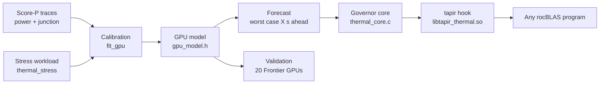

# Documentation

This project models how a GPU's junction temperature responds to its power, on liquid-cooled machines like Frontier. It then uses that model to keep the temperature steady while programs run, to reduce wear on the chip.

Each page covers one piece and stands on its own. Start here, then open only the pieces you need.

## The pieces, and how they connect

| Section | Pages | Status |
|---|---|---|
| [**The model**](model/README.md): predict junction from power | [thermal model](model/thermal-model.md), [calibration](model/calibration.md), [validation](model/validation.md), [coolant](model/coolant.md), [forecast](model/forecast.md) | Tested on real data from 20 GPUs |
| [**Control study**](control/README.md): what pacing the work could achieve | [fatigue scoring](control/fatigue-scoring.md), [sleeps and power caps](control/sleeps-and-caps.md) | Simulation only |
| [**Runtime governor**](runtime/README.md): doing it inside real programs | [governor core](runtime/governor-core.md), [tapir hook](runtime/tapir-hook.md), [telemetry](runtime/telemetry.md), [stress workload](runtime/stress-workload.md), [simulated tests](runtime/simulated-tests.md) | Built and compiled, but **never run on a GPU** |
| [**Background**](background/README.md): earlier work and data | [data](background/data.md), [cabinet model](background/cabinet-model.md), [workload stress study](background/workload-stress-study.md), [boundary layer](background/boundary-layer.md) | Earlier work; superseded by the model above where they overlap |
| [**Open questions**](open-questions.md) | | What's unproven, and the runs that would settle it |
| [**Developing on Frontier**](development.md) | | Moving the project, building, reproducing, next steps |

## Reading order

* **To use the model:** [thermal model](model/thermal-model.md), then [calibration](model/calibration.md).
* **To trust the model:** [validation](model/validation.md).
* **To run the governor:** [runtime governor](runtime/README.md), then [development](development.md).
* **To pick up development:** [development](development.md), then [open questions](open-questions.md).

## New to the physics?

Read the [primer](primer.md) first: five short ideas, each with a CS counterpart. The core of it: **each layer of the chip is an exponential moving average of power, and the model is three of them in a chain.**

## Words used throughout

| Word | Meaning | CS counterpart |
|---|---|---|
| Junction | The hottest point on the chip, as its sensor reports it | The value being predicted |
| Coolant | The water arriving at the GPU's cold plate | A slow shared resource |
| Layer | Die, package or cold plate | One EMA stage |
| R, C | How badly a layer drains heat; how much heat it holds per °C | R × C is the EMA window |
| Lift | How far a layer sits above the coolant | An EMA's current value |
| Thermal cycle | One heat-up and cool-down. Repeated cycles fatigue the chip's joints | A matched pair in rainflow counting |
| Horizon | How far ahead a forecast looks | Lookahead window |
| Gap | A short pause the governor inserts before a GPU call | Rate limiting |
| Filler | Extra GPU work the governor adds while idle, to stop the temperature dropping | Keep-alive load |
