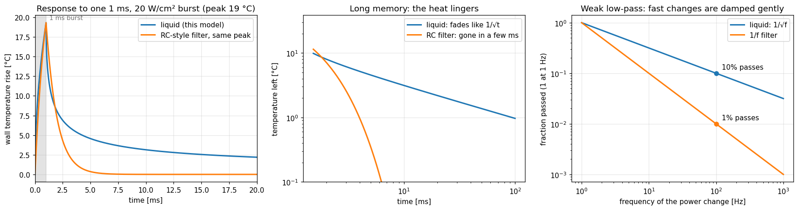

# Boundary layer

**Purpose:** the project's first study. How does the thin layer of liquid touching a hot chip surface respond to a real GPU's power trace? This uses a published model of liquid heated by a square wave of power.

**Status:** earlier work, separate from the GPU model. It models a bare surface in a liquid (fluid properties recovered from the reference paper, resembling HFE-7100), not Frontier's water cold plates. Notebook: `liquid_bl_rochpl.ipynb`; reference: `reference/liquid boundary layer under square wave heating.pdf`.

## How it works

1. Convert the rocHPL GPU power into heat flux (W/cm² of chip area).
2. Break the trace into ~7,900 square waves (on/off pulses), window by window, so the millisecond spikes are kept.
3. Apply the paper's formula (eq. 32) to each square wave, and add up the results. That works because heat conduction is linear: the response to a sum is the sum of the responses.

## Figure 1: the liquid has long memory

**What you're looking at:** the surface's response to one 1 ms burst of heat, compared with an ordinary "RC" filter (the kind of single EMA the GPU model's layers are).
* **Left:** temperature rise against time (ms).
* **Middle:** the same on log scales, showing how fast each forgets the burst.
* **Right:** what fraction of a power change gets through, against how fast it changes (Hz, cycles per second).

**What it tells you:**
* **An EMA forgets a burst within a few milliseconds.** The liquid forgets only like 1/√time, and still holds ~5% of the peak after 100 ms.
* **Fast changes are damped gently:** at 100 Hz the liquid still passes 10% of a change, against 1% for an EMA.
* So, for a surface cooled directly by liquid, fast power jitter matters more than an EMA model would suggest.

## Findings

* Power jitter causes real temperature jitter. A "few clean periodic signals" model misses it.
* HPL's two biggest thermal events are panel-step stalls and DGEMM bursts.
* The profiler's sample rate hides the sharpest spikes.
* The order and spacing of work matter, not just total energy.

## The big caveat

The formula only lets heat *in*: it has no "drain". Over the full trace the temperature climbs without bound, reaching a meaningless 8,500 °C. A rough fix, a boiling-like heat loss, makes it level off. This is a sketch, not a validated boiling model.
