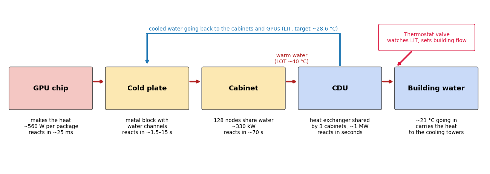
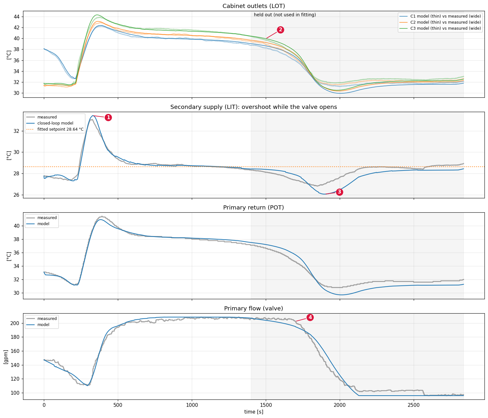

# Cabinet model

**Purpose:** model Frontier's whole cooling path, from the building's water to the GPU junction, to see how the cooling system itself changes a GPU's temperature.

**In one line:** a chain of fitted pieces, each matched to telemetry: node power → cabinet electricity → cabinet metal and water → CDU heat exchanger with a valve that reacts late → water at the GPU → the chip's three layers.

**Status:** earlier work, superseded for the GPU by the [model](../model/README.md). Its main finding, the coolant overshoot at job start, is now captured by the model's 3 [coolant](../model/coolant.md) numbers. Notebook: `frontier_cooling_group.ipynb`; code: `frontier_model.py`, `fit_cooling_model.c`, `predict_cooling.c`; working copy in `cabinet/`.

## Figure 1: the path of the heat

**What you're looking at:** the chain of components the heat passes through, left to right, each with its scale and how fast it reacts. The blue line on top is the cooled water returning to the GPUs. The red box is the valve that sets how much building water flows, based on the returning water's temperature.

**What it tells you:** each stage is slower and bigger than the one before. The chip reacts in ~25 ms, the cold plate in seconds, the cabinet in ~70 s. The valve watches only the *returning* water, so it learns about a load change late. That lag is behind Figure 2.

## Figure 2: the fitted model against the measurements

**What you're looking at:** a 30-minute rocHPL run across 3 cabinets. x axis: seconds. Gray (or wide, faint) lines are measured; thin coloured lines are the model. The shaded region (after 1,400 s) wasn't used for fitting. Panels, top to bottom:
* water leaving each cabinet (°C);
* water returning to the cabinets (°C), with the target as a dotted line;
* the building-side return water (°C);
* the valve's flow, in gallons per minute.

**How to read it.** The job starts around 220 s:
1. The returning water overshoots its 28.6 °C target by ~4.4 °C, because the valve opens too late (marker 1).
2. The model follows that overshoot and its recovery from the building water and power alone.
3. When the job ends (~1,700 s), the water undershoots (marker 3), and the real valve holds its flow longer than the model's (marker 4).

**What it tells you:**
* **The cooling system adds a temperature bump of a few degrees,** lasting minutes, at every big job start. Every GPU in the group feels it, regardless of its own work.
* **The model reproduces it to ~0.2 °C on the fitted part and 0.6–0.8 °C on unseen data.**

## Results

| What | Typical error |
|---|---|
| Cabinet outlet water, given the measured inlet | 0.12–0.19 °C |
| Whole cooling group from electricity and building water alone | ~0.2 °C fitted, 0.6–0.8 °C unseen |
| Cabinet electricity from node power | ~1.4 kW of ~330 kW |
| GPU junction on the one recorded node | ~0.75 °C |

**Key findings:**
1. **At job start the returning water peaks ~4.4 °C above target,** and every GPU runs ~4 °C hotter for a few minutes.
2. **The chip smooths its own power:** a 12 ms change moves its temperature only ~2% as much as a lasting one.
3. **Rhythm matters:** on/off faster than about once a minute is averaged out by the cooling. Every 4 minutes or slower triggers a water swing each time, adding up to ~9 °C to the chip's swing.
4. **Published conversion losses** (from ExaDigiT/RAPS) under-predict cabinet electricity by ~15 kW at idle and ~27 kW at peak.

## Limits

* **The GPU's coolant was assumed to be the cabinet inlet plus a fixed offset,** since there's no per-blade coolant telemetry. This is the weakest link, and the model page replaces it.
* **The valve controller is approximate,** and misses the hold at full flow during the wind-down.
