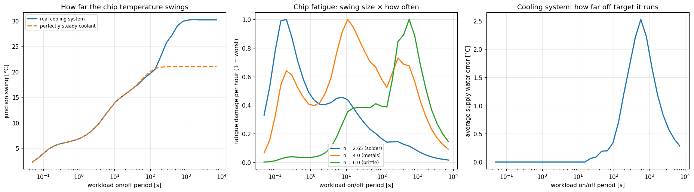
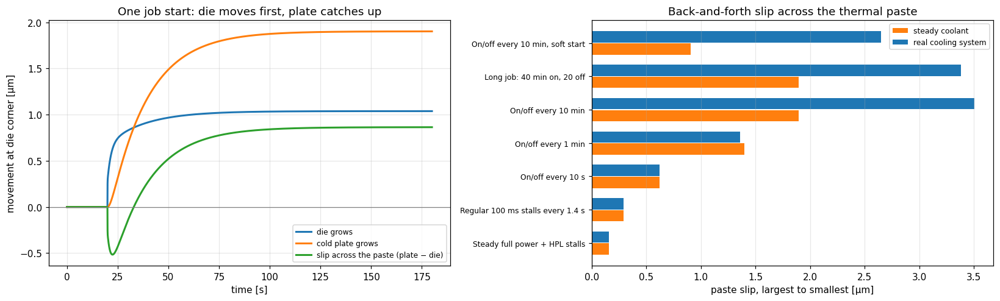

# Workload stress study

**Purpose:** using the [cabinet model](cabinet-model.md), find which workload rhythms are hardest on the cooling system and on the chip, and what could be done about them.

**Status:** earlier work, using the cabinet model. Simulation only. Notebook: `frontier_workload_stress.ipynb`.

## Figure 1: which on/off rhythm is worst?

**What you're looking at:** 34 simulated workloads, each switching between idle and full power, 50% on, with periods from 0.05 s to 2 hours. x axis: the period of one on/off cycle, on a log scale (10⁰ = 1 s, 10³ ≈ 17 minutes).
* **Left:** how far the junction swings (°C). Solid: with the real cooling system. Dashed: with perfectly steady water.
* **Middle:** fatigue damage per hour, for three values of the exponent n (q on other pages), each scaled so its own worst = 1.
* **Right:** how far the cooling water drifts from its target, on average (°C).

**What it tells you:**
* **Left:** the swing grows with the period, as slower rhythms let more layers heat up fully. Above ~2 minutes the cooling system's lag adds ~9 °C on top of the chip's own ~21 °C.
* **Middle:** the worst rhythm depends on what fails:
  * ~0.2 s for solder-like materials (n = 2.65), though those swings are small and may cause no damage;
  * ~10 s for metals (n = 4);
  * ~10 minutes for brittle layers (n = 6).
* **Right:** the cooling system's worst rhythm is ~10 minutes. That's where cooling stress and brittle-layer cracking coincide.

## Figure 2: expansion and contraction

**What you're looking at:** a model of how much each layer physically grows when heated, in µm (micrometres; a human hair is ~70 µm).
* **Left:** one job start at t = 20 s: how far the die (blue) and cold plate (orange) grow at the die's corner, and the difference between them (green). That difference is the "slip" across the thermal paste.
* **Right:** the total back-and-forth slip for several workloads, with the real cooling system (blue) and with steady water (orange).

**What it tells you:**
* **Left:** the die heats first, so the slip goes −0.5 µm. The copper plate heats later but expands more per degree, so it reverses to +0.9 µm. Every sudden job start works the paste both ways.
* **Right:** slow on/off rhythms (every 10 minutes) slip the most, and the cooling system's lag nearly doubles it. Soft starts help.

## Conclusions from the study

1. **Worst for the cooling system:** all 3 cabinets swinging together every ~10 minutes. Keeping cabinets out of step nearly removes it.
2. **Worst for the chip depends on the failure mode** (Figure 1, middle). With one worst case, it's big synchronized swings every several minutes.
3. **Cheap fixes:** a valve that also watches cabinet power (feed-forward), soft job starts, and staggering cabinets.
4. **One GPU with variable flow:** less flow means a hotter junction. The model scales the cold plate's resistance with flow, using an assumed exponent, since nothing in the data varied flow.

These findings are why the [runtime governor](../runtime/README.md) targets swings rather than temperature, and why it ramps job starts.
