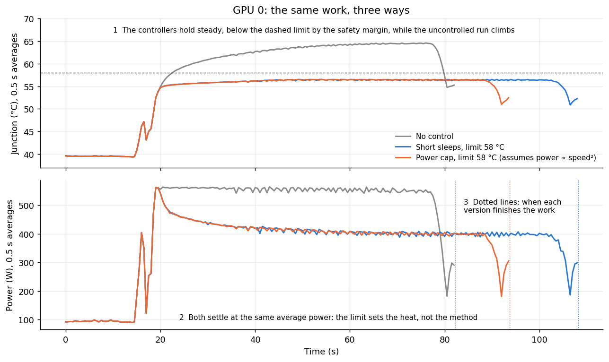
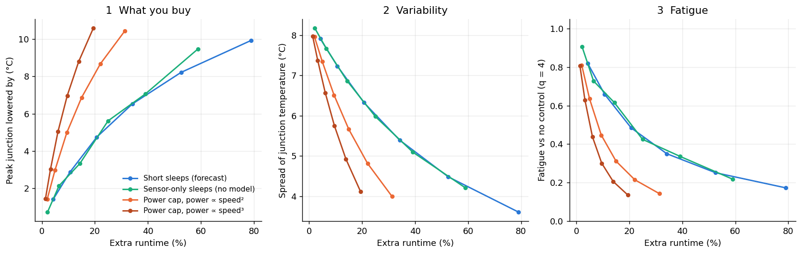
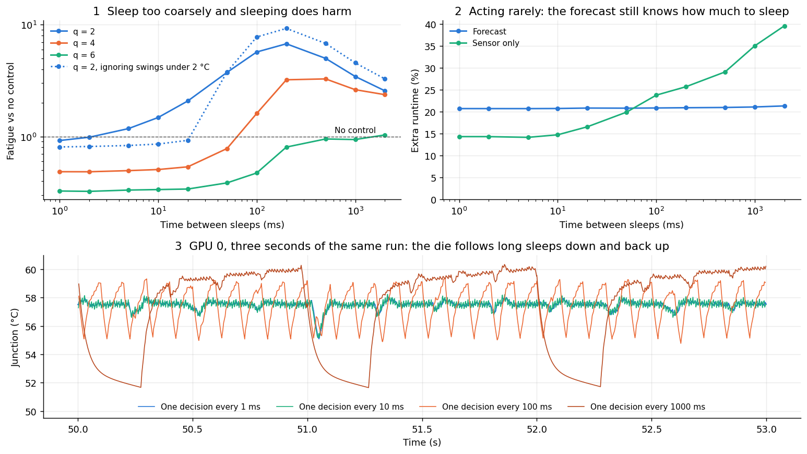

# Sleeps and power caps

**Purpose:** compare two ways of keeping a GPU cooler than its workload would make it: pausing the work in short sleeps, or slowing it with a power cap. Find what each costs and what limits it.

**In one line:** both remove the same heat, but sleeping costs more runtime, and sleeps longer than ~20 ms become thermal cycles themselves.

**Status: simulation only.** The simulator `gpu/replay_gpu.c` replays the rocHPL trace as a fixed amount of work, on a simulated GPU (the [thermal model](../model/thermal-model.md)). A pause delays the work, so the run takes longer.

**Two assumptions to check on hardware:**
* **During a sleep, the GPU draws idle power** (~90 W).
* **Under a cap, the power above idle goes as speed²:** halving the clock cuts that power to a quarter. Clock-bound work is typically between speed² and speed³. Memory-bound work may differ.

## How a decision works

The [forecast](../model/forecast.md) gives the allowed average power: the most power that keeps the junction under the limit X seconds ahead. Then either:
* **Sleep:** run at full power for part of each period and idle for the rest, so the average equals the allowed power. To get 400 W from 560 W running and 90 W idle, sleep (560 − 400) ÷ (560 − 90) = 34% of the time.
* **Cap:** set the GPU's power limit to the allowed power.

## Figure 1: the same work, three ways

**What you're looking at:** GPU 0 running the rocHPL work with a 58 °C limit. x axis: seconds.
* **Top:** junction °C. **Bottom:** power in watts. Both averaged over half seconds.
* **Gray:** no control. **Blue:** short sleeps. **Orange:** a power cap.
* **Dotted vertical lines:** when each version finishes the same work.

**How to read it:** after the job starts, gray climbs to ~65 °C. Both controlled versions flatten near 56.5 °C, kept 1.6 °C below the dashed 58 °C line by a safety margin.

**What it tells you:**
* **Both settle at the same average power (~400 W):** the limit decides how much heat is allowed, whatever the method.
* **The difference is runtime:** uncontrolled finishes at 82 s, the cap at 94 s and sleeps at 108 s. Under the speed² assumption, slowing down costs less energy per unit of work than pausing.

## Figure 2: what each method buys, for what runtime

**What you're looking at:** each point is one temperature limit, from 2 °C to 12 °C under the uncontrolled peak, averaged over 4 GPUs. x axis: extra runtime (%). y axes, left to right:
* how much the peak dropped (°C);
* the spread of temperature (standard deviation, °C);
* fatigue relative to no control (q = 4).

**How to read it:** further left is cheaper. Up (left panel) and down (middle and right) are better. The best method gets the most benefit for the least runtime.

**What it tells you:**
* **The caps (orange, brown) beat sleeping (blue).** At a limit 6 °C under the peak: sleeps cost +21% runtime and +4% energy; a cap costs +9% runtime and *saves* 6% energy. Both roughly halve fatigue.
* **Sensor-only sleeps (green) match forecast sleeps (blue)** when you can act every millisecond. Reacting is enough at that speed. The forecast's advantage is avoiding on/off chatter around each 1 °C sensor step.

## Figure 3: how long can a sleep be?

**What you're looking at:** the same limit (6 °C under the peak), the same average power. Only how often the controller acts changes: every period it sleeps first, then works.
* **Top left:** fatigue relative to no control, against time between decisions (both log scale). Above the dashed line, control does *harm*.
* **Top right:** extra runtime for forecast-based (blue) against sensor-only (green) control.
* **Bottom:** three seconds of junction temperature at four decision periods (1 ms, 10 ms, 100 ms, 1 s).

**How to read it:** the die responds in ~30 ms. Pause for much less and it doesn't notice: it only feels the average power. Pause for longer and it cools and reheats each time.

**What it tells you:**
* **Bottom:** at 1 and 10 ms the temperature is nearly flat. At 100 ms it saws 4 °C up and down; at 1 s, 8 °C, every second.
* **Top left:** past ~20–50 ms, fatigue rises above doing nothing, reaching over 3× worse at 200 ms (q = 4). **Rule: keep work-plus-sleep periods at 20 ms or less.**
* **Top right:** the forecast's cost stays at 21% however rarely it acts. Sensor-only control grows from 14% to 40%, because it can't tell how much pausing is needed.

## Power caps updated rarely

A cap has no sleep-and-wake ripple, so it can be updated rarely, which is where a forecast really pays off:

| Cap updated every | Forecast horizon | Runtime | Peak above the limit | Fatigue (q = 4) |
|---|---|---|---|---|
| 1 ms | 5 s | +9.4% | +1.0 °C | ×0.45 |
| 1 s | 5 s | +9.4% | +1.3 °C | ×0.46 |
| 5 s | 5 s | +9.3% | +1.9 °C | ×0.51 |
| 5 s | 20 s | +10.2% | +1.2 °C | ×0.46 |

**A cap updated every 1–2 s, with a 5 s forecast, is as good as millisecond control.** Set the limit 1–2 °C below what you want, since it overshoots slightly.

## Other stress tests

* **Coolant 3 °C warmer than at calibration:** the first junction reading corrects it.
* **A sudden 3 °C jump mid-run** puts the junction about 2.7 °C over the limit, which no controller could prevent, because the heat arrives at once.
* **The 30-minute 3-cabinet run:** same conclusions. A 54 °C limit (10 °C under the peak) costs +35% with sleeps or +16% with a cap.

## Code

`gpu/replay_gpu.c` (policies: none, reactive, forecast, worst, cap), `gpu/gpu_control.ipynb`.
