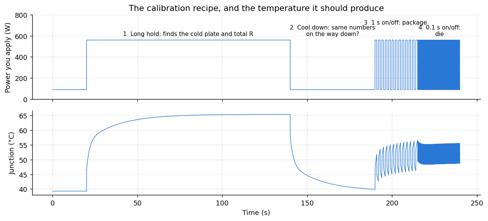

# Calibration

**Purpose:** find the model's numbers for one specific GPU, using only things you can measure on any machine: its power and its junction sensor.

**In one line:** least-squares curve fitting. Run the model over a logged power trace, compare with the logged junction, and adjust the 7 numbers until they match.

## Why this exists

Every GPU is slightly different: how well its thermal paste was applied, where it sits in the water loop. The [validation](validation.md) page shows GPUs in different slots differ by 30%. So each GPU gets its own numbers. Calibration should need nothing exotic: no coolant sensor, no facility data, and no Frontier-specific starting values, so it works on another machine like Lux.

## How it works

`fit_gpu` takes one samples file per GPU. Each line is `power_W timestamp_s junction_C`, with `nan` when there's no reading.

1. **Starting guess, from the data:** total R ≈ (hottest − coolest junction) ÷ (highest − lowest power), split across the three layers, with typical response times. Because it's sized from the data, it works for a 60 W GPU or a 1,700 W one (see below).
2. **Fit:** Levenberg-Marquardt, a standard least-squares optimiser. It nudges each of the 7 numbers (3 R, 3 C, coolant), sees how the error responds, and steps downhill. R and C are searched as logarithms so they stay positive.
3. **An honest score:** first fit on the first 70% of the run only, and report the error on the last 30%. That's a train/test split, so every calibration tells you how well it predicts data it didn't see.
4. **Optional water numbers:** if the run lasts at least 5 minutes, also try the 3 numbers for a moving coolant (see [coolant](coolant.md)). Keep them only if they cut the held-back error by at least 10%.
5. **Final fit** on the whole run.
6. **Extras for the forecast:** peak power (the highest held for 200 ms; shorter spikes are counter artifacts), idle power, and a margin (99% of sensor readings were no further above the model than this).

**Guards against junk**, each learned from a run that went wrong:
* **No time constant longer than a third of the run.** A 54 s low-power run once fitted a cold plate that took 12 minutes to respond, and a coolant of 20 °C. Nothing in that data could have shown that.
* **Warnings:**
  * the run was too short for the slowest layer;
  * power barely varied;
  * the junction moved less than 15 °C;
  * the held-back error is above 2 °C.

## Using it

```sh
./fit_gpu gpu_fit.h gpu0.txt gpu1.txt gpu2.txt gpu3.txt
```

Example output:

```
GPU 0: R 0.0159 + 0.0237 + 0.0159 = 0.0555 K/W; C 2.08, 75.9, 1059 J/K; coolant 34.3 °C; power 90 to 576 W; margin 1.6 °C
    error 0.73 °C over 7284 readings; on the last 30% when fitted only on the rest: 0.76 °C
```

To record a calibration run on any AMD GPU, use the [stress workload](../runtime/stress-workload.md): `./thermal_stress recipe --samples gpu0.txt`.

## What run to calibrate on

**The run needs a big temperature swing (at least 15 °C) and enough time at high power for the slow layer to settle.** Two tests:

**Test 1: how much of a real run is enough?** Fit on the start of the rocHPL run, and score on the rest (all 4 GPUs). The job starts 16 s in.

| Fitted on the first | Seconds of heating seen | Error on the rest (best–worst GPU) |
|---|---|---|
| 25 s | 9 s | 1.9–3.7 °C |
| 30 s | 14 s | 1.5–3.1 °C |
| 40 s | 24 s | 0.8–1.0 °C |
| 50 s | 34 s | 0.7–0.9 °C |
| 70 s | 54 s | 0.8 °C |

So about **35 s of heating** is enough. Less, and the slow cold-plate layer is a guess.

**Test 2: a recipe for any GPU.** I made up a "true" GPU, simulated a 1 °C sensor with noise, calibrated from that, then scored the result on the real rocHPL power trace. Because the truth is known here, the score is exact.

| Calibration run | Largest error, worst GPU |
|---|---|
| 1 minute: one step up and down | 1.6 °C, and `fit_gpu` warns it's too short |
| 3 minutes: one step | 2.7 °C |
| **4 minutes: step, then on/off at 1 s and 0.1 s** | **0.4 °C** |

## Figure 1: the calibration recipe



**What you're looking at:**
* **Top:** the power the recipe applies over 4 minutes: idle (~90 W) or full (~560 W).
* **Bottom:** the junction temperature it should produce.
* x axis: seconds. y axes: watts (top), °C (bottom).

**How to read it.** Each numbered section exercises one layer:
1. **Long hold at full power:** long enough for the slow cold plate to fill. This pins down the total R.
2. **Cool down:** checks the same numbers work in reverse.
3. **1 s on/off:** too fast for the cold plate to follow, so the wiggle shows the package.
4. **0.1 s on/off:** too fast for the package, so it shows the die.

**What it tells you:** a single step can't separate the three layers, because the response blends them. Adding on/off sections at different speeds isolates each one. It's like probing a cache hierarchy with different access patterns. That's why the 4-minute recipe beats a longer single step.

## Portable to other power levels

The same trace, with power scaled to mimic smaller or bigger GPUs:

| Power scaled by | Power range | Total R found | Error |
|---|---|---|---|
| 0.1 | 9–58 W | 0.582 | 0.93 °C |
| 1 | 94–577 W | 0.058 | 0.93 °C |
| 3 | 282–1730 W | 0.019 | 0.93 °C |

The same quality at every scale, with R scaling exactly inversely. Nothing in the fitter is tied to Frontier's wattage.

## Limits

* **The recipe has only been tested on a simulated GPU.** Real rocHPL runs of 82–103 s calibrate well too.
* **The coolant should stay steady during calibration,** so keep the rest of the machine quiet.
* **The water numbers need a run with a whole cooling group busy** (see [coolant](coolant.md)). A single-node run won't show them, and `fit_gpu` correctly leaves them at zero.

## Code

| File | What |
|---|---|
| `gpu/fit_gpu.c` | The fitter: about 330 lines of C, no dependencies |
| `gpu/make_samples.py` | Turns Score-P traces into samples files, using Ampere |
| `gpu/reproduce.sh` | Regenerates the samples and `gpu_fit.h`, and builds everything |
