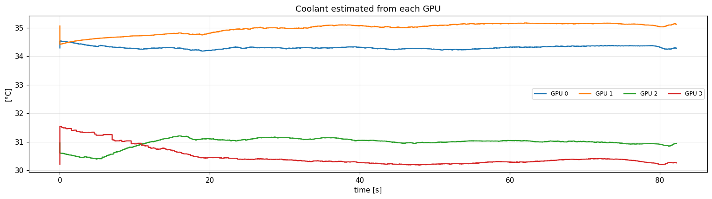
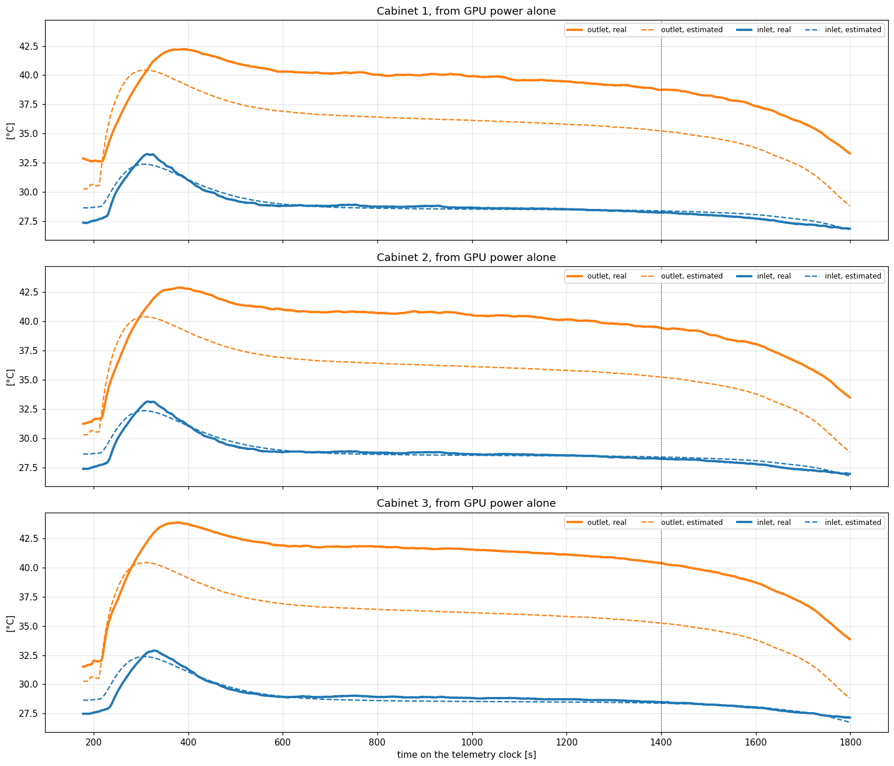
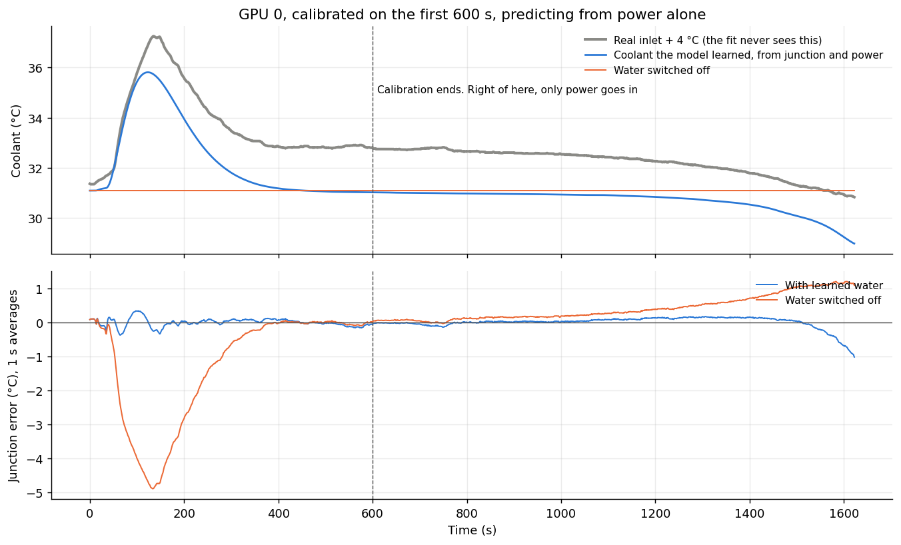

# Coolant

**Purpose:** account for the water temperature changing under the GPU, because on Frontier it does when a big job runs. That shifts every junction by the same amount.

**In one line:** the water warms when the GPUs dump heat into it, then settles back as the cooling plant catches up. The model represents that with 3 extra numbers, driven by the GPU's own power.

## Why the water moves

Frontier's GPUs sit on cold plates with water running through them. Roughly 128 nodes share a cabinet's water, and 3 cabinets share one **CDU** (coolant distribution unit), a heat exchanger that hands the heat to the building's water. A valve controls how much building water flows.

When a big job starts everywhere at once, the water warms by a few degrees for about a minute, until the valve opens and the CDU catches up. It's a shared resource with a slow feedback controller: a burst of load, a lag, then a correction.

**For one GPU, this means the junction can rise a few degrees for reasons that have nothing to do with its own work.**

## How the model handles it

Three numbers, applied to the heat the GPU puts into the water:

```
rising   moves toward (gain x heat into the water), over rise_s seconds    -- the warming
settling moves toward rising, over settle_s seconds                        -- the cooling plant catching up
coolant  = steady value + rising - settling                                -- rises, then comes back
```

It's two EMAs, one subtracted from the other: a bump that goes up and comes back down.

**One GPU can't see its neighbours.** Its own power says nothing about the 500 other GPUs in its cooling group. So `group_share` says how much of the group is assumed to be running like this GPU:
* `0`: only this GPU; the water stays steady. This is the default.
* `1`: the whole group runs the same job. Pass `group` to `predict_gpu`.

**Two ways to get the 3 numbers:**
* **From junction and power, with no inlet sensor (the goal):** `fit_gpu` tries them whenever a calibration run lasts at least 5 minutes, and keeps them if they predict held-back data better. It needs a run where the whole cooling group was busy, which doesn't exist yet with junction readings.
* **From a measured inlet temperature (what `gpu_fit.h` holds now):** `fit_water.py` fits them to the 3-cabinet run's measured inlet, using GPU power, with t < 1,400 s for fitting and the rest for testing.

## Figure 1: on a single-node run, the water is steady



**What you're looking at:** for each of the 4 GPUs in the 82 s rocHPL run, the coolant temperature worked out as `junction reading − die lift`. x axis: seconds. y axis: °C.

**How to read it:** if the water warmed during the job (which starts at 16 s), these lines would rise after 16 s.

**What it tells you:**
* **They stay flat within about ±0.5 °C.** One node can't warm a loop shared with hundreds of others, so treating the water as steady is right for single-node work.
* **The GPUs' coolant levels differ by ~4 °C** (about 30–35 °C), probably because water passes through them in sequence and warms on the way.

## Figure 2: the 3-cabinet run, predicted from GPU power alone



**What you're looking at:** a real 30-minute rocHPL run across 3 cabinets. Each panel is one cabinet. x axis: seconds on the cooling system's clock. y axis: °C.
* **Blue:** water going **into** the cabinet. **Orange:** water coming **out**.
* **Solid:** measured. **Dashed:** the model's estimate from GPU power alone (the average GPU: each cabinet's GPU power ÷ 128 ÷ 4).
* **Dotted line at 1,400 s:** the 3 water numbers were fitted only on data left of this line.

**How to read it:** the job starts at about 220 s. Measured inlet water rises ~5 °C to a peak around 310 s, then the valve opens and brings it back to ~28.5 °C. The question is whether the dashed blue line, made from power alone, tracks that bump.

**What it tells you:**
* **The inlet (blue):** the model tracks the bump and the settling. Error is 0.34–0.44 °C on the fitted part and 0.10–0.28 °C on the unseen part, against about 1 °C for assuming a fixed temperature. The peak comes out ~0.8 °C low.
* **The outlet (orange) is 3.4–5 °C too low.** GPUs make only about two-thirds of a cabinet's heat; CPUs, memory and power conversion make the rest, and this model only sees the GPUs.
* **The unseen part is only the wind-down.** It doesn't include a second job starting.

## Figure 3: can it learn this from junction and power alone?

The real test of the goal. There's no junction data from a group-wide run, so this builds a stand-in: **junction = the real measured inlet + 4 °C + each layer's lift from the real power.** The inlet and power are real; the layer response comes from the model. `fit_gpu` sees only power and junction, never the inlet.



**What you're looking at:** GPU 0, calibrated on the first 600 s, then predicted from power alone.
* **Top:** the coolant. Gray is the real inlet + 4 °C, which the fit never sees. Blue is what the model learned. Orange is with the water response switched off.
* **Bottom:** junction error in °C (1 s averages). Zero is perfect.
* **Dashed line:** the end of calibration.

**What it tells you:**
* **It learns the bump by itself:** the rise, the settling, and roughly the right timing (about 45 s), with no inlet data.
* **The junction error stays within ±0.4 °C** until the job winds down at the end, where it reaches −1 °C. With the water switched off, the error reaches −5 °C at the bump.
* **But the learned coolant *level* is ~1.8 °C too low,** because the fit raised R by 7% to compensate. From junction and power alone, "warmer water" and "slightly more resistance" look almost the same. So **trust the junction, and treat `coolant_C` as a rough estimate.**

| Calibrated on the first | Junction error after calibration | Whole run after 100 s | Same, water switched off |
|---|---|---|---|
| 400 s | 0.25 °C | 0.23 °C | 1.26 °C |
| 600 s | 0.18 °C | 0.16 °C | 1.24 °C |
| 1,000 s | 0.23 °C | 0.16 °C | 1.24 °C |
| 1,400 s | 0.42 °C | 0.18 °C | 1.22 °C |

## Limits

* **It assumes the whole group runs like this GPU** (`group`) or that nothing else moves the water. Other jobs sharing the loop are invisible from one GPU's power. A junction reading corrects for them.
* **`water_out_C` depends on an assumed flow per GPU** (`WATER_CAPACITY`), so it's a rough estimate.
* **Never tested on real junction readings from a group-wide run.**

## Code

| File | What |
|---|---|
| `gpu/gpu_model.h` | The water response (`gpu_move`) and `group_share` |
| `gpu/fit_gpu.c` | Learns the 3 numbers from junction and power, when a run shows them |
| `gpu/fit_water.py` | Fits them to a measured inlet instead, and writes them into `gpu_fit.h` |
