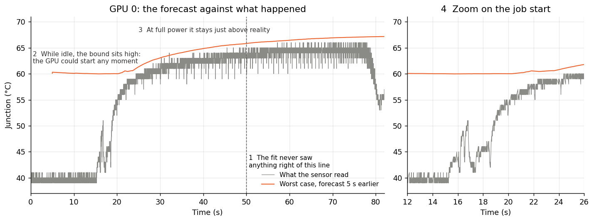

# Forecast

**Purpose:** answer, at any moment, "what's the hottest this GPU's junction could get in the next X seconds?" A runtime can then act *before* the temperature moves rather than after.

**In one line:** because the model is linear, the junction X seconds from now is a dot product of the current state with precomputed weights, plus a weight times the power to come. Assume peak power, and you have the worst case.

## Why this exists

Reacting to the temperature sensor is too late for some decisions: the sensor reports whole degrees, and a reaction only starts once the heat is already in. A forecast lets a [governor](../runtime/README.md) decide how much work to allow over the next few seconds while it can still matter.

## How it works

The junction at the horizon (X seconds ahead) depends on two things: what's already stored in each layer, and what power comes next. Being linear, they add:

```
junction in X s = coolant
                + a x die_lift + b x package_lift + c x plate_lift     // what's already there, partly drained
                + d x power from now until then                         // what's coming
```

`gpu_forecast_start` finds a, b, c and d once, by running the model forward with each input set to 1 and the rest to 0. Each forecast is then four multiplications.

For GPU 0 at X = 5 s: a = 0.003, b = 0.11, c = 0.72, d = 0.0395 °C/W. Read that as follows:
* **After 5 s the die has forgotten almost everything** (0.3% of its lift is left), while the cold plate still holds 72%. The slow layer is the memory.
* **Each watt held for 5 s adds 0.04 °C,** so 500 W adds about 20 °C.

**Worst case:** more power can only make the junction hotter, so the worst case is holding **peak power** (found at calibration) for the whole horizon, plus a safety **margin** (how far the sensor read above the model in 99% of calibration readings).

**"Likely" case:** assume the power of the last 0.2 s continues.

```c
GpuForecast f;
gpu_forecast_start(&f, fit, 5.0);                  // once
double worst = gpu_worst_case(&state, fit, &f);    // hottest it could be in 5 s
double allowed = gpu_allowed_power(&state, fit, &f, 60.0);  // the most power that stays under 60 °C over those 5 s
```

`gpu_allowed_power` is the same equation solved for power. It's what the governor uses.

## Figure 1: the worst-case forecast against what happened



**What you're looking at:** GPU 0 in the rocHPL run, fitted on the first 50 s only. x axis: seconds. y axis: junction °C.
* **Gray:** what the sensor read.
* **Orange:** the worst-case forecast made 5 seconds earlier, shifted right by 5 s so both line up in time.
* **Right panel:** a zoom on the job start.

**How to read it:** the forecast is a promise: "it won't be hotter than this in 5 s". If the promise holds, orange stays above gray.

**What it tells you:**
* **While idle (left of 16 s), the bound sits ~20 °C high.** That's correct, not slack: the question is "what if full load started right now?", and 5 s of full power really would do that.
* **At full power it sits about 1–1.5 °C above reality,** mostly the safety margin.
* **The job start (zoom) is the hardest moment,** and the bound still holds.

## Results

Across all 4 GPUs, checking the hottest sensor reading in each window against the forecast made at its start:

| Horizon | Part of the run | Bound held (worst GPU) | Largest miss | Average gap above reality |
|---|---|---|---|---|
| 1 s | whole run | 98.2% | 0.68 °C | 3.5 °C |
| 5 s | whole run | 97.3% | 0.46 °C | 3.9 °C |
| 5 s | last 32 s, never seen by the fit | 100% | 0 | 1.1 °C |
| 10 s | last 32 s, never seen by the fit | 100% | 0 | 0.9 °C |

The "likely" forecast is a different story. Assuming recent power continues barely beats assuming nothing changes (1.55 against 1.69 °C at 1 s, and equal by 10 s). **The model knows the physics, but not what the program will do next.** So use the worst case for decisions, and don't expect an accurate "most likely" forecast unless you know the upcoming work. The [governor](../runtime/governor-core.md) partly does that, since it sees each rocBLAS call before it runs.

## Limits

* **Peak power comes from calibration.** A heavier workload than the calibration run could exceed the bound, so calibrate with your hardest load.
* **Tested on one job, on one node.**

## Code

`gpu/gpu_model.h`: `gpu_forecast_start`, `gpu_junction_after`, `gpu_worst_case`, `gpu_allowed_power`. `predict_gpu ... horizon=5` adds both forecasts as columns.
