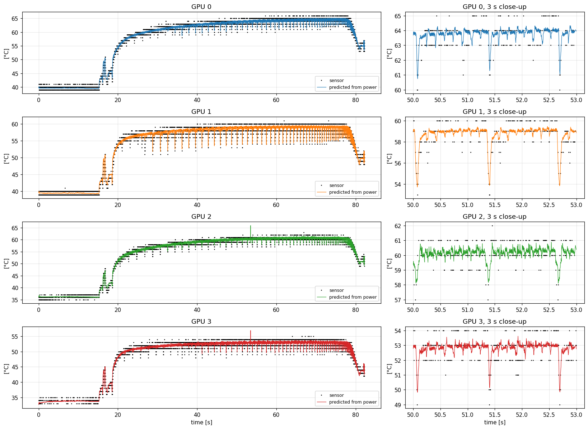
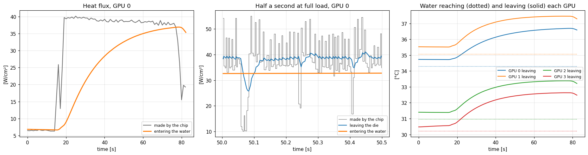

# The thermal model

**Purpose:** turn a GPU's power log into its junction temperature, the temperature of the hottest point on the chip, which is what wears the chip out.

**In one line:** three exponential moving averages in a chain, fed by power, sitting on top of the water temperature. If that's unfamiliar, read the [primer](../primer.md) first.

## Why this exists

You can log a GPU's power cheaply and often (every 1–3 ms, from its energy counter). The junction sensor is coarser (whole °C, every ~6.5 ms), and nothing tells you what the temperature will be a few seconds from now. A model that maps power to temperature lets you:
* predict the temperature from power alone, even without a sensor;
* see how much each layer of the chip is heating up;
* simulate "what if the work were paced differently" before doing it;
* forecast the next few seconds, which is what the [governor](../runtime/README.md) needs.

## How it works

```
power --> [ die ] --R1--> [ package ] --R2--> [ cold plate ] --R3--> water (coolant)
            C1               C2                  C3
```

Each box is one layer, and each holds a **lift**: how many °C it sits above the water. Every millisecond the model does what an EMA update does, layer by layer:

```c
die_to_package   = (die - package) / R[0];       // heat flowing down, in watts
package_to_plate = (package - plate) / R[1];
plate_to_water   = plate / R[2];
die     += dt * (power - die_to_package) / C[0]; // each layer: (heat in - heat out) / buffer size
package += dt * (die_to_package - package_to_plate) / C[1];
plate   += dt * (package_to_plate - plate_to_water) / C[2];

junction = coolant + die;                         // the die's lift sits on top of the water
```

The fitted numbers for one MI250X package (GPU 0 in the rocHPL trace):

| | Die | Package | Cold plate | Total |
|---|---|---|---|---|
| R: °C of rise per watt | 0.016 | 0.024 | 0.016 | 0.055 |
| C: joules per °C | 2.1 | 76 | 1,059 | |
| How fast it responds (the EMA window) | 0.03 s | ~1.5 s | ~16 s | |

So 560 W settles the junction 31 °C above the water. The die gets most of the way within a tenth of a second, and the cold plate takes about a minute.

**Outputs:** besides the junction, the model reports the coolant estimate, the water leaving the GPU, and the heat flux at each stage, in W/cm² of die area. That's how much heat is being made per square centimetre, how much is leaving the die, and how much is entering the water.

**With a sensor:** if a junction reading arrives, `coolant = reading − die lift`, smoothed over 10 s. That keeps the absolute level honest if the water temperature differs from the calibration day.

## Using it

Command line: power in, temperature out.

```sh
./predict_gpu 0 power.txt > predicted.csv      # each line of power.txt: power_W timestamp_s [junction_C]
```

From C, for example inside a profiler:

```c
#include "gpu_model.h"
#include "gpu_fit.h"
GpuState state;
gpu_start(&state, &GPU_FITS[0], first_power_W, 0.0, first_time_s);
GpuPrediction p = gpu_predict(&state, &GPU_FITS[0], power_W, NAN, time_s);   /* NAN = no sensor reading */
/* p.junction_C, p.coolant_C, p.water_out_C, p.flux_generated, p.flux_die_exit, p.flux_to_water */
```

Each call costs about 25 ns.

## Figure 1: the model against the sensor, on a real rocHPL run



**What you're looking at:** four GPUs (rows) during an 82 s rocHPL run on one Frontier node.
* **Left:** the whole run.
* **Right:** a 3-second close-up at full load.
* **Black dots:** the junction sensor. **Coloured line:** the model's prediction from power alone.
* **x axis:** seconds since the trace started. **y axis:** junction temperature in °C.

**How to read it:**
* The job starts at about 16 s. The temperature jumps about 15 °C in a couple of seconds (the die and package reacting), then creeps up another ~10 °C over a minute (the cold plate filling up).
* The downward spikes on the plateau are HPL's short stalls, when power briefly drops.
* The sensor's dots form horizontal bands because it only reports whole degrees.

**What it tells you:** the model follows the start, the slow creep, every stall and the end of the job. Its typical error is 0.72–0.78 °C. Much of that is the sensor rounding and flickering rather than the model: in the close-ups, the line runs through the middle of the dots.

This figure is fitted and scored on the same run. The honest test, on data the fit never saw, is on the [validation](validation.md) page.

## Figure 2: where the heat goes



**What you're looking at:** the model's view inside the stack. y axes are in W/cm²: watts per square centimetre of chip. The die is about 14.5 cm², so 40 W/cm² is about 580 W.
* **Left:** heat made by the chip (gray) against heat reaching the water (orange), over the whole run.
* **Middle:** half a second at full load: heat made (gray steps), heat leaving the die (blue), heat reaching the water (orange).
* **Right:** water arriving at each GPU (dotted) and leaving it (solid), in °C.

**What it tells you:**
* **Left:** the water only receives the heat about a minute later. The cold plate is a big buffer.
* **Middle:** the chip's power jumps around from millisecond to millisecond, but by the time the heat leaves the die it's already smoothed. By the time it reaches the water it's flat. Each layer is a low-pass filter.
* **Right:** at full load the water warms by about 2.4 °C passing each GPU. That number depends on an *assumed* flow rate (about 3.2 L/min per GPU), so treat it as a rough estimate.

## Limits

* **Linear:** it assumes twice the power means twice the lift. That held across 20 GPUs (see [validation](validation.md)).
* **One junction sensor per package,** read in whole degrees, so detail below ~1 °C is invisible to the fit.
* **The die layer's 30 ms response** is at the edge of what 3 ms power samples can show.

## Code

| File | What |
|---|---|
| `gpu/gpu_model.h` | The model, about 200 lines of C. Also the forecast functions (see [forecast](forecast.md)) |
| `gpu/gpu_fit.h` | The fitted numbers, one row per GPU, written by `fit_gpu` |
| `gpu/predict_gpu.c` | The command-line tool |
