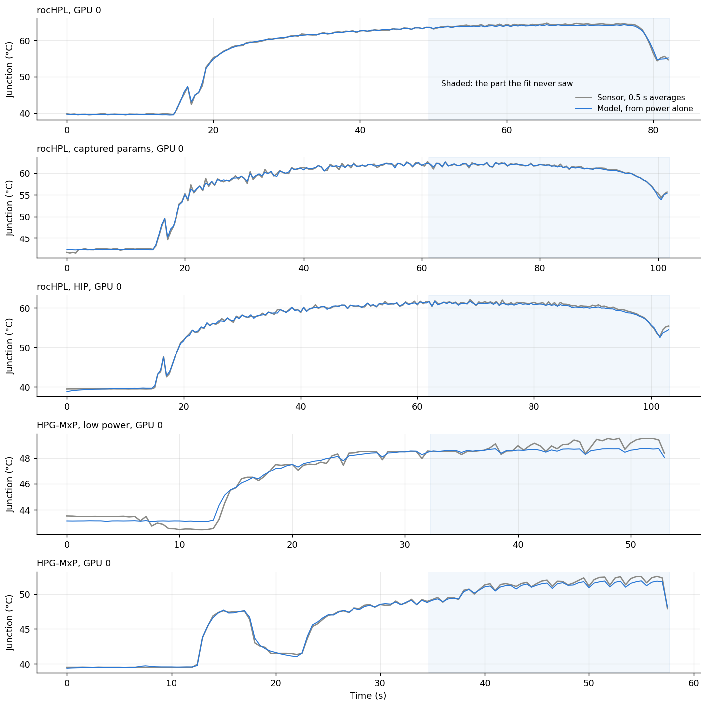
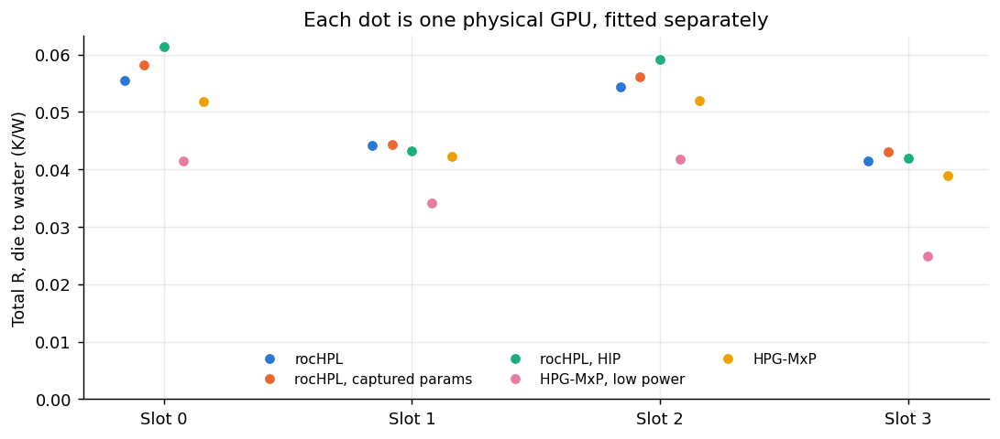

# Validation

**Purpose:** show how well the model predicts junction temperature on data it was never fitted to, on real Frontier GPUs, and where it falls short.

**In one line:** fit on the first 60% of each run, predict the last 40% from power alone, then compare with the sensor. That's 20 GPUs, 5 nodes and 3 kinds of job.

## Why this exists

A model can always match the data it was fitted on. What matters is predicting new data. This page tests that four ways:
1. **Within a run:** the unseen end of the same run.
2. **The right size:** whether 3 layers is the right number.
3. **Across jobs:** a different job, on a different GPU.
4. **Across power levels:** GPUs with very different wattages.

## The data

Five Score-P traces, each from a different Frontier node, so 20 physical GPUs. Each has power every 3–9 ms and the junction sensor every ~6.5–20 ms.

| Job | Node | Length | Junction swing |
|---|---|---|---|
| rocHPL | frontier05319 | 82 s | 27 °C |
| rocHPL, captured params | frontier05987 | 102 s | 25 °C |
| rocHPL, HIP | frontier06446 | 103 s | 26 °C |
| HPG-MxP, low power | frontier03455 | 54 s | 8 °C |
| HPG-MxP | frontier00995 | 58 s | 15 °C |

**Two scores, because the sensor flickers.** It reports whole degrees and jumps ±1 °C even when nothing changes. So:
* **"vs raw sensor":** compared with every reading. It can't get near zero, however good the model.
* **"vs 0.5 s averages":** both sides averaged over half-second bins. This removes most of the flicker and shows the model's real error.

## Test 1: predict the unseen end of each run

| Job | Error vs raw sensor | Error vs 0.5 s averages | Sensor's own flicker |
|---|---|---|---|
| rocHPL | 0.79 °C | 0.31 °C | 0.99 °C |
| rocHPL, captured params | 0.88 °C | 0.25 °C | 1.47 °C |
| rocHPL, HIP | 0.88 °C | 0.30 °C | 1.46 °C |
| HPG-MxP, low power | 0.67 °C | 0.36 °C | 0.59 °C |
| HPG-MxP | 0.87 °C | 0.60 °C | 0.86 °C |
| **All 20 GPUs** | **0.82 °C** | **0.36 °C** (worst GPU 0.75) | |

The error against raw readings is about the size of the sensor's own flicker, so most of it is the sensor.

### Figure 1: one GPU from each job

**What you're looking at:** five panels, GPU 0 of each job. x axis: seconds. y axis: junction °C.
* **Gray:** the sensor, averaged over half seconds.
* **Blue:** the model, from power alone.
* **Shaded area:** the 40% of the run the fit never saw.

**How to read it:** in the shaded area the model gets no temperature information at all, only power. If the blue line stays on the gray one there, the model predicts rather than memorises.

**What it tells you:**
* **rocHPL (top three):** the lines overlap almost everywhere, including fast dips and the final drop.
* **HPG-MxP (bottom two):** close, but the model drifts up to ~0.8 °C low by the end. These runs are short, so the fit saw only ~20 s of load, and the slow layer wasn't fully pinned down.

## Test 2: is three layers the right number?

More layers always fit the training data better, so the test is unseen data:

| Layers | Error vs raw sensor | Error vs 0.5 s averages |
|---|---|---|
| 1 | 1.91 °C | 1.58 °C |
| 2 | 1.15 °C | 0.85 °C |
| **3** | **0.83 °C** | **0.35 °C** |
| 4 | 0.84 °C | 0.37 °C |

Three is right: two is clearly worse, and four adds nothing. A telemetry delay, a power-dependent gain and an extra slow term also made no difference.

## Test 3: calibrate on one job, predict another

What you really want is to calibrate once, then predict *other* jobs on that GPU. **No node appears in two traces, so this can't be tested directly.** The closest available test is harder: calibrate on one job's GPU, then predict a different job on a **different GPU in the same slot** (same position in its node). The coolant is set once from the idle stretch at the start; after that, only power goes in.

| Calibrated on → predicting | Error vs 0.5 s averages |
|---|---|
| Any rocHPL → a different job | **0.95 °C** on average (0.44–1.58 °C) |
| Low-power HPG-MxP → rocHPL | 3.7–4.7 °C (don't calibrate on a gentle job) |
| Any rocHPL → low-power HPG-MxP | ~1.5 °C (see below) |

### Figure 2: each GPU's total resistance, by slot

**What you're looking at:** each dot is one physical GPU, fitted separately. x axis: its slot (0–3) in the node. y axis: its total R, the °C of rise per watt once settled. Colours are the five jobs and nodes.

**How to read it:** if the fit were just curve-fitting noise, the dots would scatter randomly. If it measures real hardware, GPUs in the same slot should agree, because they're plumbed the same way.

**What it tells you:**
* **Same-slot GPUs on different nodes agree:** slots 0 and 2 are about 0.056 °C/W, and slots 1 and 3 about 0.044. The fit is measuring physical hardware, probably the order the water passes through each node's GPUs. That's also why predicting another GPU in the same slot works at all.
* **The pink dots (low-power HPG-MxP) sit about 25% lower:** that job got less temperature rise per watt. My best guess is that at low power, more of the counted power goes to memory, which doesn't heat the junction. Power alone can't reveal that, so it's a limit of any power-only model.

## Test 4: other power levels

Scaling a trace's power by 0.1×, 1× and 3× gives identical error, with R scaling exactly. See [calibration](calibration.md#portable-to-other-power-levels).

## What's not tested yet

| Not tested | Why | What would test it |
|---|---|---|
| The same GPU on two different jobs | No node appears twice | Two jobs on one node, with the junction sensor on |
| Learning the coolant from real junction readings | All traces are single-node | A job filling a cooling group for 10+ minutes ([coolant](coolant.md)) |
| Another GPU type | Only MI250X data | A calibration run on Lux |

## Code

`gpu/gpu_validation.ipynb` (generated by `gpu/make_validation_notebook.py`) runs all of this. The samples come from `gpu/make_samples.py`, which reads the traces through Ampere.
