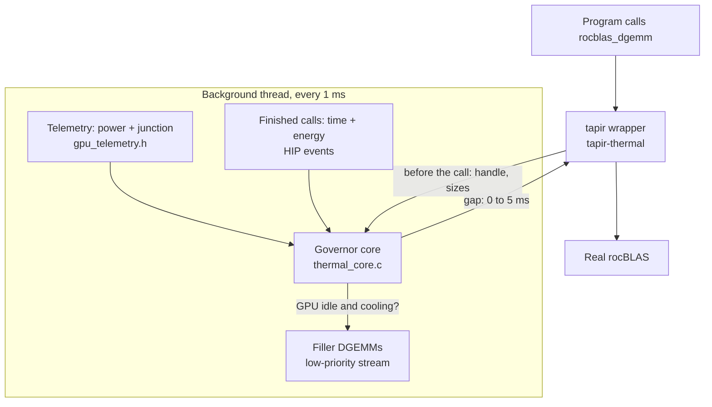

# Runtime governor

**Purpose:** keep a GPU's junction temperature steady while an unmodified program runs, by pacing its rocBLAS calls: short gaps when it would get too hot, filler work when it would cool too far.

**In one line:** an `LD_PRELOAD` library, built on [tapir](https://github.com/adam-mcdaniel/tapir), that intercepts each rocBLAS call, forecasts the junction a few seconds ahead, and inserts a gap of up to 5 ms if needed.

**Status: built, compiled and type-checked, but never run on a GPU** (there was no ROCm where it was written). The decision logic is tested against a simulated GPU. Everything that touches HIP, rocBLAS or rocm_smi is untested.

## How the pieces fit



| Page | What it covers |
|---|---|
| [Governor core](governor-core.md) | How each decision is made, the settings, and why they're shaped this way |
| [tapir hook](tapir-hook.md) | How calls are intercepted, and what happens around each one |
| [Telemetry](telemetry.md) | Reading power and junction through rocm_smi |
| [Stress workload](stress-workload.md) | A rocBLAS program that swings the temperature on purpose, for calibration and testing |
| [Simulated tests](simulated-tests.md) | What the governor did to a simulated GPU, and its three presets |

## Quick start on Frontier

```sh
cd gpu/runtime
module load rocm
./build.sh                                            # thermal_stress, test_core, libtapir_thermal.so

# 1. Calibrate (about 5 minutes per GPU)
./thermal_stress recipe --device 0 --samples gpu0.txt
../fit_gpu gpu_fit.h gpu0.txt

# 2. The same fixed amount of work, without and with the governor
./thermal_stress random --work --samples off.txt
TAPIR_PROFILERS="thermal(fit=gpu_fit.h,log=on.csv)" LD_PRELOAD=$PWD/libtapir_thermal.so \
    ./thermal_stress random --work --samples on.txt
```

Compare `off.txt` and `on.txt` (junction swings, runtime) with the tools in `gpu/thermal_metrics.py`. `dry_run=1` makes all the decisions and logs them, but doesn't apply them, which is a safe first test.

## The main trade-off

One setting, `rise`, chooses between runtime and steadiness (see [simulated tests](simulated-tests.md)):

| Preset | `rise` | Runtime | Energy | Fatigue (q = 4) | Peak |
|---|---|---|---|---|---|
| Gentle | 5 | +0% | up to +48% | ×0.2–0.36 on on/off work | a few °C hotter |
| **Balanced (default)** | 1 | +5–15% | up to +48% | ×0.17–0.23 on on/off work, ×0.87 on rocHPL | ~1–3 °C hotter on on/off work |
| Strict | 0.2 | +49–68% | +9–45% | ×0.02–0.46 | 3–9 °C cooler |

**Why strict costs so much:** flattening work that's busy half the time, by pausing it, means running it at its average power. That roughly doubles the time spent. A power cap would be cheaper (see [sleeps and power caps](../control/sleeps-and-caps.md)), but isn't built yet.

## Code

`gpu/runtime/`: `thermal_core.h/.c`, `thermal_rocm.c`, `gpu_telemetry.h`, `tapir-thermal/`, `thermal_stress.c`, `test_core.c`, `test_governor.py`, `build.sh`, `README.md`.
