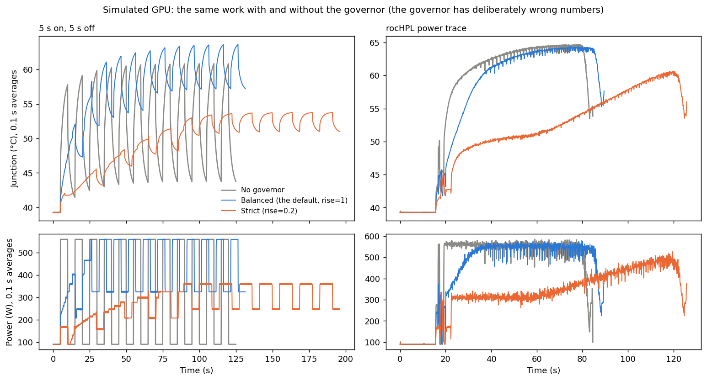

# Simulated tests

**Purpose:** test the [governor core](governor-core.md)'s decisions without a GPU, by putting it in front of a simulated one, and measure what it buys and costs.

**In one line:** `test_core.c` simulates a GPU with the thermal model, runs four workloads through it with and without the governor, and `test_governor.py` scores the results.

## The setup

* **The simulated GPU** uses GPU 0's numbers from `gpu/gpu_fit.h`.
* **The governor gets deliberately wrong numbers:** R +8%, C −15%, coolant +0.5 °C, as a real calibration would be slightly off.
* **It sees what it would on hardware:** power every millisecond, and the junction every 6.5 ms in whole degrees.
* **Each workload is a fixed amount of work,** so gaps make it take longer.

| Workload | What it is |
|---|---|
| 5 s on, 5 s off | 1 ms DGEMM-like calls at 560 W, alternating with idle |
| 50 ms on, 50 ms off | A fast on/off that hammers the die |
| Random | On and off for random lengths, 20 ms to 10 s |
| rocHPL trace | The real power trace, replayed as calls |

## Figure 1: with and without the governor



**What you're looking at:** two workloads (columns). Top: junction °C. Bottom: power in watts. Both averaged over 0.1 s. x axis: seconds.
* **Gray:** no governor. **Blue:** the default (balanced). **Orange:** strict.

**How to read it (left, 5 s on/off):**
* **Gray** swings ~17 °C every cycle: up during work, down during idle.
* **Blue** keeps the idle phases warm with filler (power ~320 W instead of 90 W), so it swings only ~7 °C. But it sits higher overall, so its peaks are ~3 °C hotter than gray's.
* **Orange** paces the work as well (power below 560 W during "on") and holds the temperature near the middle. Its peaks are cooler and its swings small, but the run takes much longer.

**How to read it (right, rocHPL):**
* **Blue** turns the job start into a ramp of about 1 °C/s, then mostly leaves the plateau alone. rocHPL's biggest swing is the job starting and stopping, which a following target lets through.
* **Orange** ramps more slowly and holds the plateau lower.

## Results

Fatigue is relative to no governor (see [fatigue scoring](../control/fatigue-scoring.md)):

| Workload | Preset | Runtime | Energy | Peak | Fatigue q=4 | q=6 |
|---|---|---|---|---|---|---|
| 5 s on/off | balanced | +5% | +36% | 60.9 → 63.7 °C | ×0.19 | ×0.33 |
| | strict | +57% | +37% | 60.9 → 53.9 °C | ×0.02 | ×0.01 |
| | gaps only | +6% | +2% | 60.9 → 60.9 °C | ×0.90 | ×0.89 |
| 50 ms on/off | balanced | +15% | +38% | 54.5 → 57.1 °C | ×0.17 | ×1.10 |
| | strict | +68% | +38% | 54.5 → 51.2 °C | ×0.03 | ×0.10 |
| Random | balanced | +5% | +48% | 62.6 → 63.7 °C | ×0.23 | ×0.35 |
| | strict | +49% | +45% | 62.6 → 53.9 °C | ×0.03 | ×0.02 |
| rocHPL trace | balanced | +6% | +1% | 65.1 → 64.7 °C | ×0.87 | ×0.90 |
| | strict | +49% | +9% | 65.1 → 61.0 °C | ×0.46 | ×0.35 |

**What it tells you:**
* **Filler is what removes swings cheaply,** but it costs energy and lifts the peak a few degrees. Without filler ("gaps only"), the default barely helps.
* **Strict removes nearly all the wear,** but costs about half again the runtime. With pausing as the only lever, that cost is physical.
* **On the 50 ms on/off load the default makes q = 6 slightly worse** (×1.10). The filler raises the peak, and heavy-wear scoring cares most about peaks.

## Reproducing

```sh
cd gpu/runtime && python test_governor.py      # builds test_core, prints the table, draws governor_test.png
./test_core square on out.csv rise=0.2         # one run with your own settings
```

## Limits

* **The simulated GPU is the model itself,** so the model is assumed to be right. Only its numbers are wrong.
* **Gaps are assumed to drop power to idle instantly,** and filler to share the GPU perfectly. Real hardware won't be that tidy.

## Code

`gpu/runtime/test_core.c`, `gpu/runtime/test_governor.py`.
