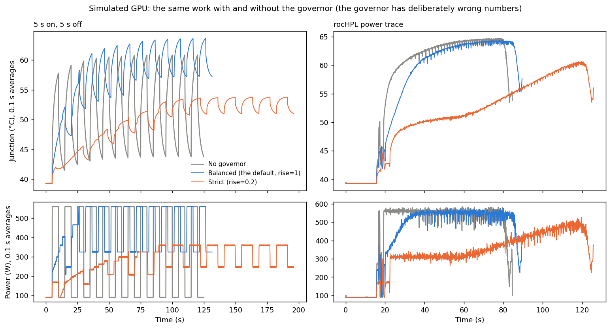

# Thermal governor

Keeps a GPU's junction temperature steady while a program runs, by pacing its rocBLAS calls. It uses the GPU model in `../gpu_model.h`, calibrated with `../fit_gpu` from power and the junction sensor alone.

```
program --rocblas_dgemm--> tapir wrapper --> real rocBLAS
                               |
                               v
        before each call:  forecast X seconds ahead. Too hot by then?  -> a short gap first
        while GPU idle:    forecast X seconds ahead. Too cold by then? -> filler DGEMMs on a low-priority stream
        every 1 ms:        read power and junction (rocm_smi) -> update the model
                           time each finished call (HIP events) -> learn what each kind of call costs
```

**Status: not yet run on a GPU.** The decision logic has been tested on a simulated GPU (below). The GPU-facing code compiles and the tapir library type-checks, but neither has run against ROCm. The stress workload's schedule was checked against a fake rocBLAS.

## On Frontier

```sh
module load rocm
./build.sh                         # thermal_stress, test_core, libtapir_thermal.so (fetches tapir from GitHub)
```

**1. Calibrate each GPU (about 5 minutes per GPU, or run them in parallel with --device):**

```sh
./thermal_stress recipe --device 0 --samples gpu0.txt
../fit_gpu gpu_fit.h gpu0.txt                       # one samples file per GPU, in device order
```

On an MI250X, the two GCDs in a package share one energy counter, which only the even-numbered device reports. For an odd GCD, pass `--smi` with its partner's rocm_smi index. Its "power" is then the whole package's.

**2. Stress the cooling, without the governor:**

```sh
./thermal_stress chirp --from 0.01 --to 60 --seconds 300 --samples chirp.txt
```

**3. Govern a program:**

```sh
TAPIR_PROFILERS="thermal(fit=gpu_fit.h,log=thermal.csv)" LD_PRELOAD=$PWD/libtapir_thermal.so ./app
```

To compare like with like, run the same fixed amount of work with and without it. Gaps then show up as a longer run:

```sh
./thermal_stress random --work --samples off.txt
TAPIR_PROFILERS="thermal(fit=gpu_fit.h,log=on.csv)" LD_PRELOAD=$PWD/libtapir_thermal.so ./thermal_stress random --work --samples on.txt
```

`dry_run=1` makes every decision and logs it, but doesn't apply it.

## The stress workload

`thermal_stress` runs DGEMMs back to back for "on" and idles for "off". Each pattern pushes a different part of the cooling:

| Pattern | What it does | Why |
|---|---|---|
| `square --period S --duty F` | on/off at a fixed period | The textbook case. A period of 30-60 s should give the largest swing per cycle, since the cold plate (~16 s) has time to heat and cool. A 50-100 ms period works the die alone |
| `chirp --from S --to S` | a square wave whose period sweeps on a log scale | One run passes through the die's (~30 ms), the package's (~1.5 s) and the cold plate's (~16 s) response times, so it shows which period swings the junction most |
| `random --shortest S --longest S` | random on and off lengths, log-uniform | No period to settle into or learn. The hardest case for anything predictive |
| `steps --levels 0,0.5,1 --hold S` | held power levels | Whether the model is linear in power |
| `recipe` | `fit_gpu`'s 4-minute calibration run | Calibration |

`--size` sets the DGEMM size (default 4096). `--samples` logs power and junction every millisecond in `fit_gpu`'s format. `--schedule` logs what was asked for.

## Settings

All of them go in `TAPIR_PROFILERS="thermal(name=value,...)"`:

| Setting | Default | What it does |
|---|---|---|
| `fit`, `gpu` | `$THERMAL_FIT` or `gpu_fit.h`; the program's device | The calibrated numbers, and which GPU's |
| `horizon` | 5 | Seconds ahead the forecast looks |
| `band` | 1 | °C the junction may stray either side of the target |
| `rise`, `fall` | 1, 0.05 | °C per second the target may rise and fall. **`rise` sets the trade-off**: see below |
| `setpoint` | `follow` | A fixed target in °C instead |
| `ceiling` | `none` | °C the target never exceeds: a hard cap on the level |
| `max_gap` | 0.005 | The longest gap before one call, in seconds. Longer gaps become thermal cycles of their own |
| `fill`, `fill_size` | 0.001, 2048 | Seconds of filler per piece (0 = never fill), and the filler DGEMM's size |
| `log`, `log_every` | none, 0.01 | A CSV of power, junction, model, target, band, worst case, gaps and fills |
| `smi` | found from the PCI address | rocm_smi's number for the GPU |
| `dry_run` | 0 | 1 = decide and log, but don't apply |

**How it decides.** The forecast turns "stay under the top of the band by the horizon" into an allowed average power. A call that draws more than that runs at a duty below 1, and the gap before it makes up the rest:

```
duty = (allowed power - idle power) / (this kind of call's power - idle power)
gap  = this kind of call's run time x (1 - duty) / duty,  at most max_gap
```

Each kind of call (the function, its sizes to the nearest power of two, and its modes) has its own learned run time and power. A new kind is assumed to run at peak power until measured. Filler is the mirror image: the least average power that keeps the junction above the bottom of the band.

The target follows the junction, but it may only rise at `rise` and fall at `fall`. Over the horizon, the band may move up by `rise x horizon`.

## What it does to a simulated GPU

`python test_governor.py` builds `test_core` and runs it on four workloads. The simulated GPU uses GPU 0's numbers from `../gpu_fit.h`. The governor is given deliberately wrong numbers (R +8%, C −15%, coolant +0.5 °C), and sees power every millisecond and the junction every 6.5 ms in 1 °C steps. Each workload is a fixed amount of work, so gaps make it take longer.



Fatigue is relative to no governor, using rainflow cycle counting and Coffin-Manson with exponent q (an assumption: about 2 for solder, higher for other materials):

| Workload | Setting | Runtime | Energy | Peak | Fatigue q=4 | q=6 |
|---|---|---|---|---|---|---|
| 5 s on, 5 s off | balanced (default) | +5% | +36% | 60.9 → 63.7 °C | ×0.19 | ×0.33 |
| | strict (`rise=0.2`) | +57% | +37% | 60.9 → 53.9 °C | ×0.02 | ×0.01 |
| | gaps only (`fill=0`) | +6% | +2% | 60.9 → 60.9 °C | ×0.90 | ×0.89 |
| 50 ms on, 50 ms off | balanced | +15% | +38% | 54.5 → 57.1 °C | ×0.17 | ×1.10 |
| | strict | +68% | +38% | 54.5 → 51.2 °C | ×0.03 | ×0.10 |
| Random, 20 ms to 10 s | balanced | +5% | +48% | 62.6 → 63.7 °C | ×0.23 | ×0.35 |
| | strict | +49% | +45% | 62.6 → 53.9 °C | ×0.03 | ×0.02 |
| rocHPL power trace | balanced | +6% | +1% | 65.1 → 64.7 °C | ×0.87 | ×0.90 |
| | strict | +49% | +9% | 65.1 → 61.0 °C | ×0.46 | ×0.35 |

**Three ways to trade, set by `rise`:**

* **Balanced (the default):** a few percent of runtime. Filler lifts the dips, which costs energy and makes the hot parts a little hotter: about +1-3 °C on the peaks for on/off work.
* **Strict (`rise=0.2`):** flattens the temperature towards the middle, removing most of the fatigue and lowering the peak, but sleeping instead of running costs about half again the runtime. That cost is physical: holding a workload that's busy half the time at its average temperature by pausing means running at its average power.
* **Gentle (`rise=5`):** no runtime cost; filler alone does the work.

**rocHPL gains little at the default,** because its big swing is the job starting and ending, and a following target lets that through. Use `strict`, or `ceiling` for a hard cap on the level.

## Limits

* **Never run on a GPU.** The decision logic is tested against the same model it uses, with wrong numbers. A real GPU will be less tidy.
* **A gap stops the stream:** the GPU finishes what it has queued, then idles. Calls launched far ahead lose their overlap whenever a gap is needed.
* **The filler competes with the program** on the same GPU, on a low-priority stream, in 1 ms pieces. If the program comes back mid-piece, it may wait up to that long.
* **A call can't be split.** A 100 ms DGEMM is one 100 ms burst, which is long enough to cycle the die. Splitting large calls into pieces would fix this, but isn't done.
* **Power during a short gap is assumed to fall to idle.** A real GPU may not drop that fast.
* **Several processes on one GPU** each govern on their own, without knowing about each other.
* **The cost model learns each kind of call's power from the energy counter.** For calls much shorter than the counter's 1 ms sampling, that's an average over neighbouring calls.

## Files

| File | What it is |
|---|---|
| `thermal_core.h`, `.c` | The decisions, in plain C with no GPU code. The caller supplies the clock, telemetry and calls |
| `thermal_rocm.c` | Connects the core to HIP, rocBLAS and rocm_smi, looked up at run time |
| `gpu_telemetry.h` | The energy counter and junction sensor through rocm_smi |
| `tapir-thermal/` | The tapir preload library: rocBLAS wrappers generated from the ROCm headers, which call the C |
| `thermal_stress.c` | The stress workload |
| `test_core.c`, `test_governor.py` | The simulated-GPU test, and the script that runs it and draws `governor_test.png` |
| `build.sh` | Builds everything on a machine with ROCm |
